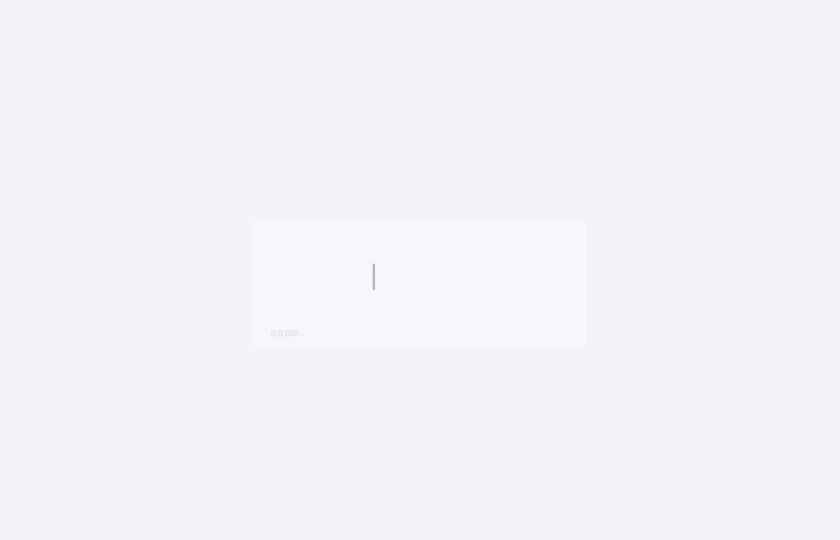
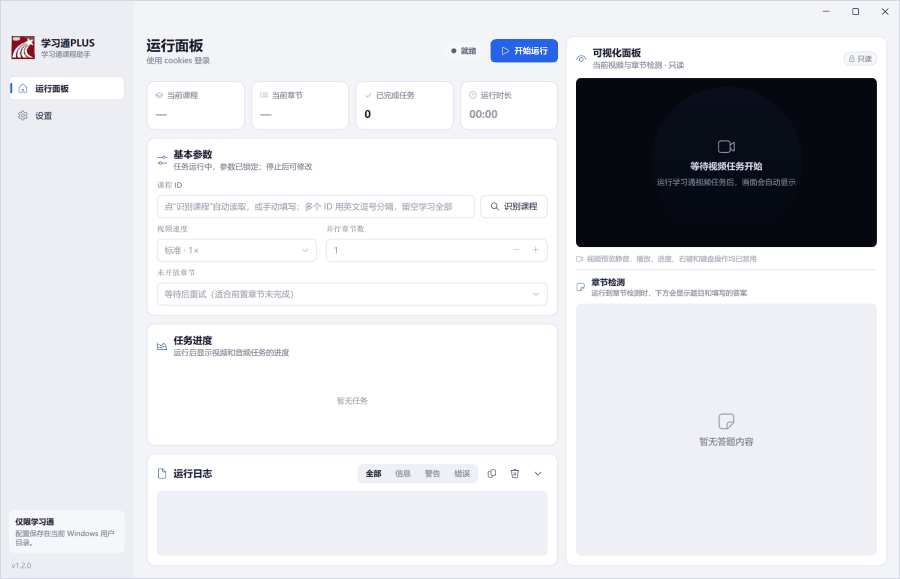
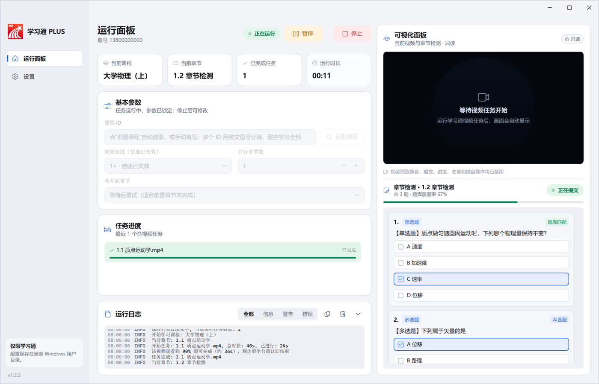
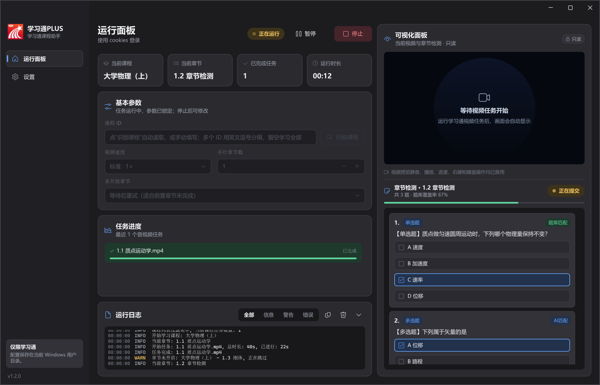
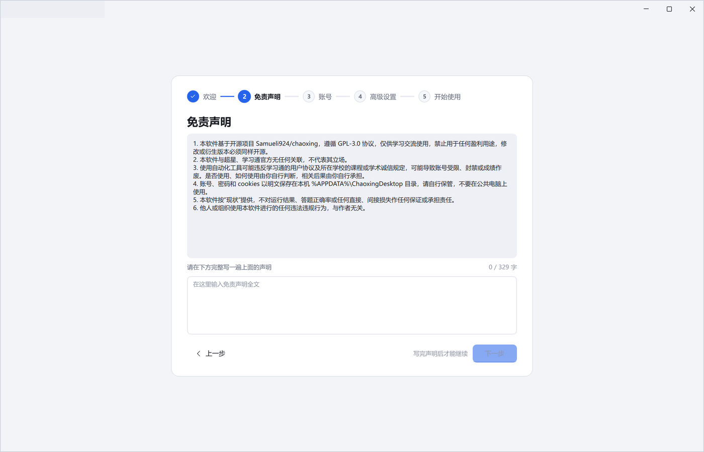
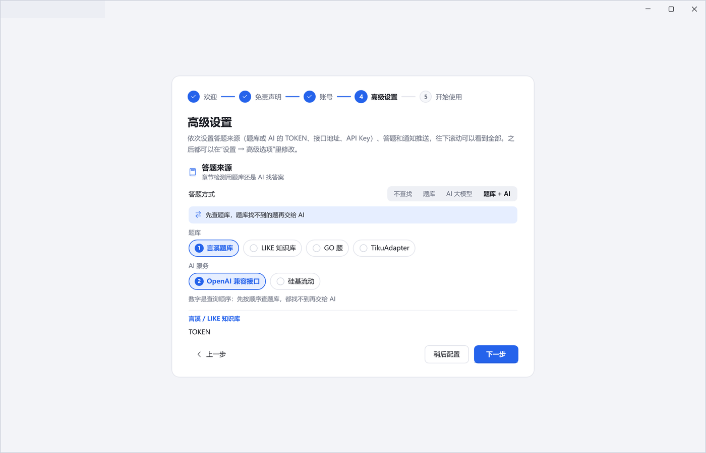
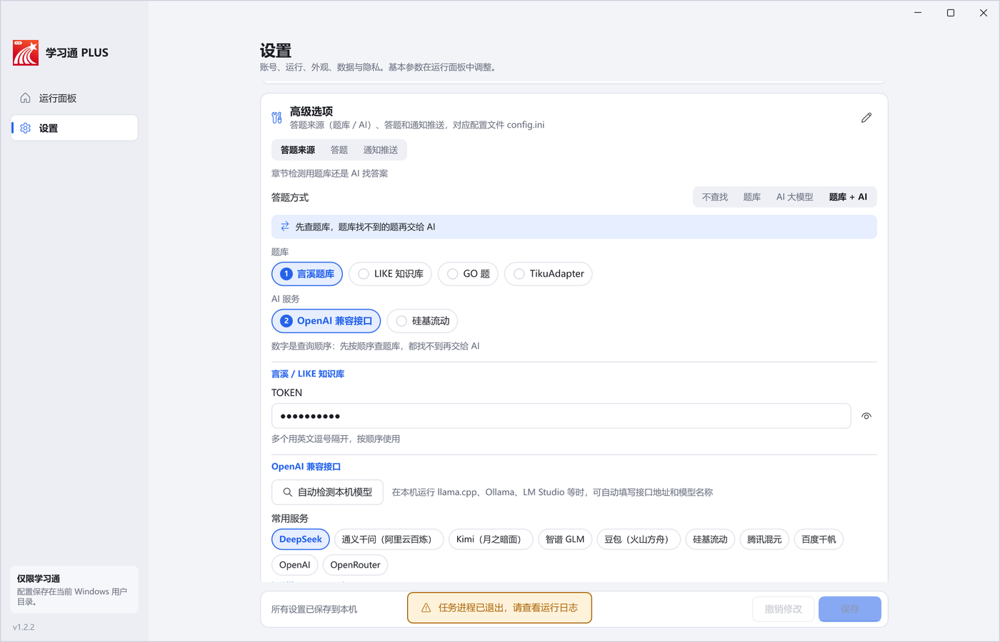
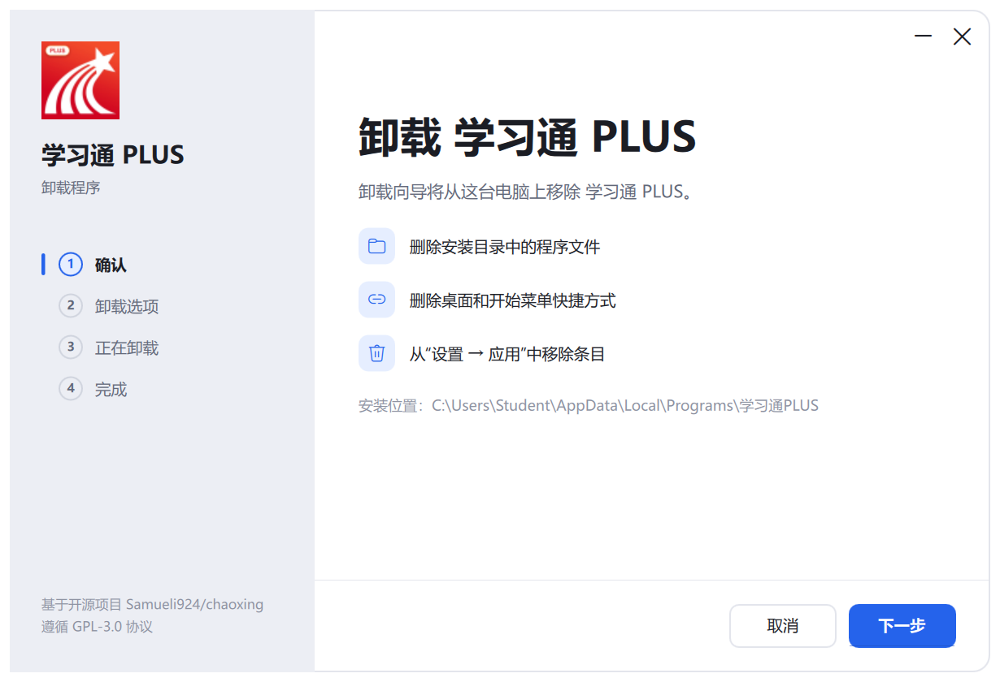
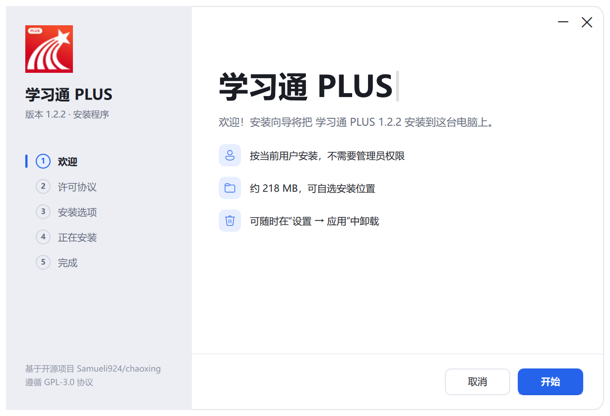
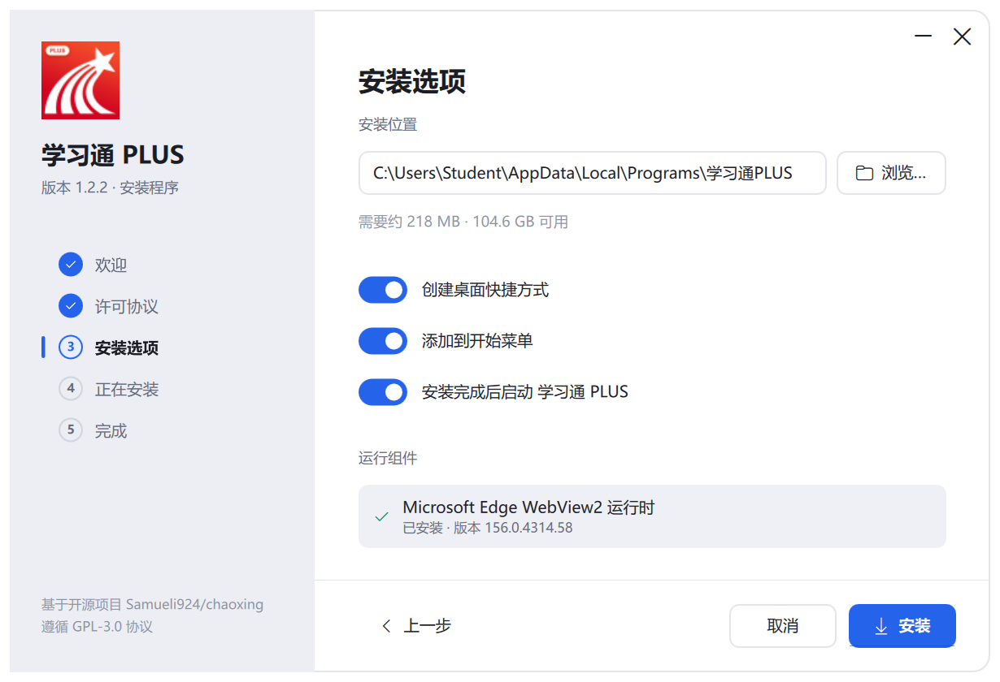

<p align="center">
  
</p>

<h1 align="center">学习通PLUS</h1>

<p align="center">
  超星学习通桌面客户端 · 基于开源项目 <a href="https://github.com/Samueli924/chaoxing">Samueli924/chaoxing</a>
  <br>
  <a href="../../releases/latest"></a>
  
  
</p>

<p align="center">
  
</p>

---

## 一、软件介绍

学习通PLUS 把原本的命令行工具做成了一个 Windows 桌面应用：所有配置都在界面里完成（包括原来要手改 `config.ini` 的题库、AI 和通知推送），首次启动的引导就能一次配好；运行状态、当前视频和章节检测实时可见。AI 既可以用本机模型（llama.cpp、Ollama、LM Studio 等，自动检测），也可以用 DeepSeek、通义千问、Kimi、智谱等云端服务（自动识别服务商、列出可用模型）。

<p align="center">
  
</p>

> 截图和动图使用模拟数据录制（v1.2.0），不对应任何真实账号或课程。录制时没有真实视频，视频预览区域显示的是等待状态；实际使用时会显示当前课程视频，并与任务进度同步。

### 主要特性

- **运行面板**：左侧是仪表盘（当前课程、章节、已完成任务、运行时长）、基本参数、音视频任务进度和可筛选的运行日志；顶部有 开始运行 / **暂停（继续）** / 停止。暂停时正在进行的请求先完成，暂停的时间不计入视频观看时长和运行时长。
- **只读可视化面板**：右侧上半部分是当前任务的视频（静音、不可操作），播放位置和倍速跟任务进度一致，切换页面回来接着播，任务看完显示“已看完”；下半部分是章节检测的题目和填写的答案，题目一读到就先显示，每题标注 **题库匹配 / AI匹配 / 随机作答**（查找时显示“查找中”），以及覆盖率和提交状态。界面只用于查看。
- **高级选项**：原来要手动编辑 `config.ini` 的配置都有了界面。
  - **答题来源**：答题方式可选“不查找 / 题库 / AI 大模型 / 题库 + AI”，只显示所选来源需要填写的内容（TOKEN、接口地址、API Key、模型等，密钥默认隐藏）。
  - **本机模型**：“自动检测本机模型”找到本机运行的 llama.cpp、Ollama、LM Studio、vLLM 等（包括非默认端口），一键填好接口地址和模型名称；本机服务不需要 Key，也不走代理。
  - **云端模型**：常用服务一键填写接口地址（DeepSeek、通义千问、Kimi、智谱 GLM、豆包、硅基流动、腾讯混元、百度千帆、OpenAI、OpenRouter），任意地址都能自动识别服务商；填好 API Key 后“获取模型列表”，搜索并点选要用的模型。
  - **答题 / 通知推送**：提交与覆盖率（默认 75%）、查题间隔、答错重做、判断题“正确 / 错误”的写法；Server酱、Qmsg酱、Bark、Telegram 推送。开始运行前会检查必填项。
- **后台运行**：关闭窗口后留在系统托盘，任务继续；托盘菜单可以显示窗口、开始/停止任务、退出。
- **课程选择**：不填写课程 ID 时，运行后会弹出课程列表供勾选。
- **Fluent 风格界面**：浅色 / 深色 / 跟随系统，全程动画过渡；自绘标题栏（最小化 / 最大化 / 关闭，拖动移动、双击最大化，边缘可调整大小）。窗口最小化或隐藏到托盘时停止动画、释放视频预览，日志很长时也保持流畅。
- **启动画面**：程序在后台加载配置和界面，加载完成后进入主窗口。
- **首次启动引导**：欢迎 → 免责声明 → 账号 → 高级设置（答题来源、答题、通知推送，与“设置 → 高级选项”相同）→ 开始使用；账号和高级设置都可以稍后再配置。引导内容更新后会重新显示一次。
- **自制安装程序**：按当前用户安装，不需要管理员权限，支持升级；会检查 WebView2 运行时，缺少时从微软官网下载并校验签名后安装。卸载程序与安装程序同样是向导样式，卸载时默认清除账号数据。安装后约 220 MB。
- **联网更新**：从本仓库的 GitHub Releases 检查新版本，下载后校验 SHA-256 再安装。
- **数据与隐私**：配置、cookies 和日志只保存在本机 `%APPDATA%\ChaoxingDesktop`；设置里可以一键清除账号数据和运行日志，界面和日志不显示本机路径。

### 截图

| 运行面板（上：视频 · 下：章节检测） | 深色模式 |
| --- | --- |
|  |  |

| 首次启动引导 · 免责声明 | 首次启动引导 · 高级设置 |
| --- | --- |
|  |  |

| 高级选项（云端模型 · 常用服务） | 卸载程序 |
| --- | --- |
|  |  |

| 安装程序 · 欢迎 | 安装程序 · 选项 |
| --- | --- |
|  |  |

---

## 二、如何使用

### 1. 安装

1. 在 [Releases](../../releases) 下载 `XueXiTong-Plus-Setup-<版本>.exe`。
2. 双击运行，按向导完成安装：接受许可协议 → 选择安装位置和快捷方式 → 安装。
   - 默认安装到 `%LOCALAPPDATA%\Programs\学习通PLUS`，不需要管理员权限。
   - 已安装旧版本时再次运行会直接升级，配置不受影响。
3. 视频预览需要 Microsoft Edge WebView2 运行时：Windows 11 已自带；缺少时安装程序会在“安装选项”页提示，并可从微软官网下载安装。

也可以下载 `XueXiTong-Plus-Windows-<版本>.zip` 免安装使用：解压后运行 `学习通PLUS.exe`，保持 `chaoxing-worker.exe` 和 `_internal` 文件夹在同一目录。免安装版不会自动安装 WebView2 运行时。

**安卓手机（测试版）**：在 Releases 下载 `XueXiTong-Plus-Android-<版本>.apk` 安装（需要允许“安装未知应用”，Android 7.0 及以上；纯血鸿蒙不能安装 APK）。手机版与电脑版版本号同步、任务逻辑相同，首次打开同样有引导；最后一步“后台保活”请按提示允许通知、关闭电池优化、打开自启动和后台运行，否则息屏后任务可能被系统停止。手机版答题的 AI 只支持模型公司的云服务 API，没有自动验证码识别。

### 2. 首次启动

第一次打开会进入开始引导：

1. **欢迎**：了解主要功能。
2. **免责声明**：阅读声明，并在输入框中完整写一遍，内容一致后才能继续。
3. **账号**：填写学习通账号和密码，或开启 cookies 登录（把 `cookies.txt` 放入配置目录）。暂时不想填可以点“稍后配置”，之后在 **设置 → 账号** 中填写；没配置前运行面板顶部会一直提醒。
4. **高级设置**：依次设置答题来源、答题和通知推送（做法见下面的“配置答题来源”）。缺少必填项时底部会提示；可以点“稍后配置”，之后在 **设置 → 高级选项** 中修改。
5. **开始使用**：进入运行面板。

### 3. 运行任务

1. 在运行面板左侧的 **基本参数** 里设置课程 ID（留空则运行时选择）、视频速度、并行章节数和未开放章节的处理方式。
2. 点击 **开始运行**。参数会自动保存，运行期间锁定。
3. 在左侧查看进度和日志，在右侧可视化面板查看当前视频（与任务进度同步）和章节检测的题目、答案来源。
4. 需要时点击 **暂停**（正在进行的请求完成后停下，暂停的时间不计入视频观看时长），再点 **继续** 接着运行；点击 **停止** 结束任务。

其他选项在 **设置** 页：账号、重试间隔、运行结束提醒、章节学习次数、**高级选项**、主题和动画、数据与隐私（清除账号数据 / 运行日志、恢复默认设置）。

### 4. 配置答题来源（设置 → 高级选项 → 答题来源）

先选 **答题方式**：不查找 / 题库 / AI 大模型 / 题库 + AI（先查题库，找不到再交给 AI）。勾选的题库或 AI 服务上的数字是查询顺序。

- **题库**：选择言溪、LIKE 知识库、GO 题或 TikuAdapter，填写对应的 TOKEN、授权码或服务地址。
- **本机模型**（llama.cpp、Ollama、LM Studio 等）：先启动模型服务，在“OpenAI 兼容接口”下点 **自动检测本机模型**，在找到的模型后面点 **使用**，接口地址和模型名称就填好了。本机服务不需要 API Key，也不要填代理。
- **云端模型**：
  1. 在 **常用服务** 里点服务商（如 DeepSeek、通义千问），或自己填写接口地址（填到 `/v1` 即可，不要带 `/chat/completions`）；下方会显示“识别为：服务商”。
  2. 填写在服务商控制台申请的 **API Key**。
  3. 点 **获取模型列表**，在列表里搜索并点选要用的模型；也可以直接填写模型名称。
  4. 需要翻墙访问的服务才填“代理”。

**答题** 页：达到覆盖率时是否提交（默认开启）、最低覆盖率（默认 75%）、查题间隔、答错后是否重做、判断题“正确 / 错误”的写法。**通知推送** 页：任务结束或出错时推送到手机。

改完点底部的 **保存**。仍然可以点高级选项右上角的按钮直接编辑 `config.ini`，各配置项的含义见 [docs/CLI.md](docs/CLI.md)。

### 5. 更新

程序启动时会自动检查新版本（可在 **设置 → 关于** 关闭），也可以手动点击“检查更新”。发现新版本后点击“下载并安装”即可，配置和账号不受影响。

### 6. 卸载

在 Windows **设置 → 应用** 中找到 学习通PLUS 卸载，或运行安装目录中的 `学习通PLUS.exe --uninstall`。卸载向导依次为 确认 → 卸载选项 → 正在卸载 → 完成；默认勾选“清除账号数据（账号、密码、cookies）”，也可以选择删除全部配置、日志和界面设置。

### 从源码构建

需要 Windows 10/11 x64 和 PowerShell：

```powershell
pwsh -NoProfile -ExecutionPolicy Bypass -File .\build_windows.ps1
```

脚本会准备便携 Python 和依赖，生成：

- `dist\学习通PLUS\`：免安装程序目录
- `dist\XueXiTong-Plus-Windows-<版本>.zip`：免安装压缩包
- `dist\XueXiTong-Plus-Setup-<版本>.exe`：安装程序

开发者说明见 [CLAUDE.md](CLAUDE.md)，命令行用法见 [docs/CLI.md](docs/CLI.md)。

---

## 三、关于原仓库

学习通PLUS 基于 [**Samueli924/chaoxing**](https://github.com/Samueli924/chaoxing)（超星学习通自动化完成任务点，命令行版）开发。任务处理、登录、题库对接等核心逻辑均来自原仓库及其贡献者；本项目在此基础上增加了桌面界面、可视化面板、安装程序等。

- 原仓库地址：<https://github.com/Samueli924/chaoxing>
- 原仓库贡献者：<https://github.com/Samueli924/chaoxing/graphs/contributors>
- 命令行版使用说明（来自原仓库）：[docs/CLI.md](docs/CLI.md)

感谢原作者和所有贡献者的开源工作。

### 许可与免责声明

- 本项目与原仓库一样遵循 [GPL-3.0](LICENSE) 协议：允许开源 / 免费使用、引用、修改和衍生；衍生版本必须同样以 GPL-3.0 开源；**禁止将本项目或其衍生版本作为闭源商业软件发布或销售，禁止用于盈利**。
- 本软件与超星、学习通官方无任何关联。程序图标以学习通官方图标为底图制作，相关商标归其权利人所有。
- 使用自动化工具可能违反学习通用户协议及学校的课程或学术诚信规定，可能导致账号受限、封禁或成绩作废，相关后果由使用者自行承担。
- 本代码仅用于学习讨论，他人或组织使用本代码进行的任何违法违规行为与作者无关。
