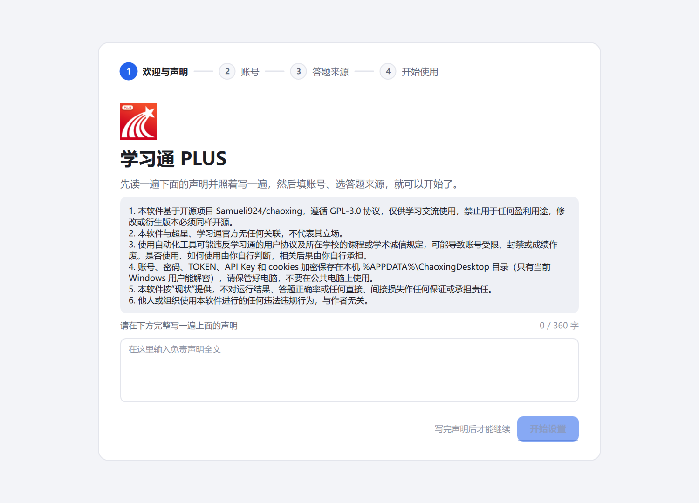
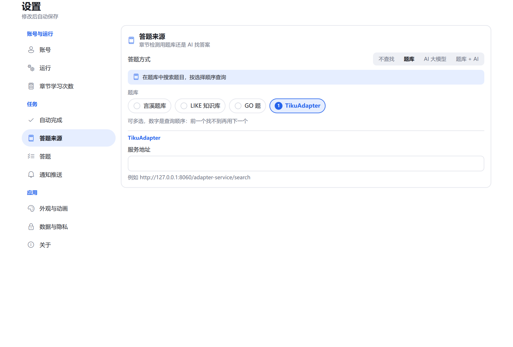
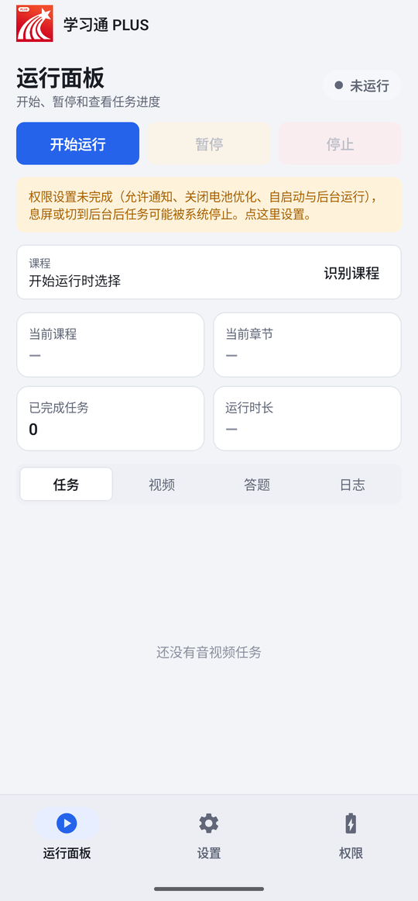
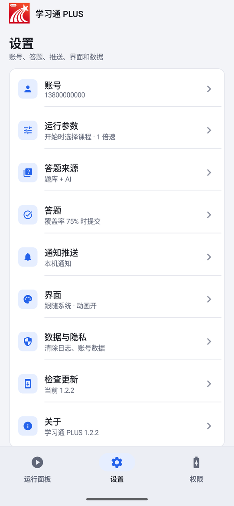
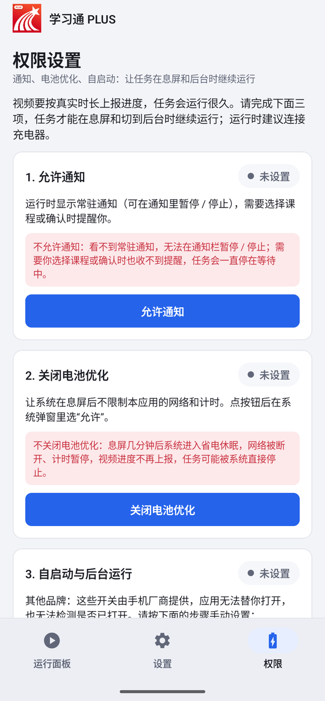

<p align="center">
  
</p>

<h1 align="center">学习通 PLUS</h1>

<p align="center">
  超星学习通的 Windows 桌面应用和安卓应用：视频、章节检测、课件、直播、作业自动完成，开源、免费、无广告。
</p>

<p align="center">
  <a href="https://github.com/Kerxs/XueXiTong-Plus/releases/latest"></a>
  <a href="https://github.com/Kerxs/XueXiTong-Plus/releases"></a>
  <a href="LICENSE"></a>
  
</p>

<p align="center">
  <a href="https://github.com/Kerxs/XueXiTong-Plus/releases/latest">下载</a> ·
  <a href="https://github.com/Kerxs/XueXiTong-Plus/releases">更新说明</a> ·
  <a href="PRIVACY.md">隐私说明</a> ·
  <a href="#从源码构建">从源码构建</a>
</p>

<p align="center">
  
</p>

## 功能

- **自动完成**：视频和音频、章节检测、课件和文档、直播、作业。阅读、问卷、讨论等需要你自己完成的内容会提醒你。
- **答题来源**：题库（言溪、LIKE 知识库、GO 题、TikuAdapter）、AI 大模型，或先题库后 AI。AI 支持 DeepSeek、通义千问、Kimi、智谱等云端服务和本机模型（llama.cpp、Ollama、LM Studio），题目里的图片也能识别。
- **看得见**：运行面板显示课程、章节、每个任务的进度和日志；预览面板显示正在看的视频和正在答的题，多个章节并行时可以切换或平铺。
- **不容易卡住**：断网等网络恢复、章节出错自动重试、任务进程意外退出自动重新开始；可以暂停和继续。
- **后台运行**：关闭窗口后留在系统托盘继续运行；任务结束或出错时可以推送到手机。
- **手机版**：与电脑版同一套任务逻辑，用系统通知提醒，带后台保活的权限引导。
- **数据在本机**：账号、密码、Key 加密保存在本机；匿名统计只有数字，可以关闭，见 [隐私说明](PRIVACY.md)。

> 自动化不能保证 100% 成功：视频可能遇到验证码或平台限制，章节检测和作业可能答错。

## 下载

| 系统 | 下载 | 说明 |
| --- | --- | --- |
| Windows 10 / 11 | [安装程序](https://github.com/Kerxs/XueXiTong-Plus/releases/latest)（`XueXiTong-Plus-Setup-*.exe`） | 推荐。按当前用户安装，不需要管理员权限；可以在应用内更新 |
| Windows 10 / 11 | [免安装版](https://github.com/Kerxs/XueXiTong-Plus/releases/latest)（`XueXiTong-Plus-Windows-*.zip`） | 解压后运行 `学习通PLUS.exe` |
| Android 7.0 及以上 | [APK](https://github.com/Kerxs/XueXiTong-Plus/releases/latest)（`XueXiTong-Plus-Android-*.apk`） | 测试版。需要允许“安装未知应用”；纯血鸿蒙不能安装 |

视频预览需要 Microsoft Edge WebView2 运行时：Windows 11 自带，缺少时安装程序会从微软官网下载安装。

## 截图

| 运行面板 | 深色模式 |
| --- | --- |
|  |  |

| 开始引导 | 设置 |
| --- | --- |
|  |  |

| 手机 · 运行 | 手机 · 设置 | 手机 · 权限 |
| --- | --- | --- |
|  |  |  |

截图和动图用模拟数据录制，不对应任何真实账号或课程。运行面板和手机的截图来自较早的版本，界面细节可能与当前版本不同。

## 使用

1. **安装并打开**。第一次打开有四步引导：欢迎与声明 → 账号 → 答题来源 → 开始使用。免责声明需要照着完整输入一遍。
2. **选课程**。在运行面板的“基本参数”里点“识别课程”勾选，或留空，开始运行后再选。
3. **开始运行**。左边看进度和日志，右边看当前视频和答题。可以暂停、继续、停止。
4. **设置**。左边选分类，右边改，改完自动保存。答题来源、自动完成的范围、通知推送都在这里。

答题来源怎么配：

- **题库**：选一个题库，填它的 TOKEN 或服务地址。
- **云端 AI**：选服务商，填 API Key，点“获取模型列表”选模型。
- **本机模型**：先启动模型服务，点“自动检测本机模型”。

应用会自动检查新版本，下载后校验再安装，配置不受影响。卸载在 Windows“设置 → 应用”里，或运行安装目录里的 `卸载学习通PLUS.exe`。

命令行用法和 `config.ini` 各项的含义见 [docs/CLI.md](docs/CLI.md)。

## 从源码构建

Windows 10 / 11 x64，PowerShell：

```powershell
pwsh -NoProfile -ExecutionPolicy Bypass -File .\build_windows.ps1
```

生成 `dist\XueXiTong-Plus-Setup-<版本>.exe`、`dist\XueXiTong-Plus-Windows-<版本>.zip` 和 `dist\学习通PLUS\`。

- 安卓版：见 [android/README.md](android/README.md)。
- 统计后台（Cloudflare Worker）：见 [server/telemetry/README.md](server/telemetry/README.md)。
- 开发说明：[CLAUDE.md](CLAUDE.md)；开发工具和检查命令：[requirements-dev.txt](requirements-dev.txt)。

## 致谢

学习通 PLUS 基于 [Samueli924/chaoxing](https://github.com/Samueli924/chaoxing) 开发，登录、任务处理和题库对接的核心逻辑来自原仓库及其[贡献者](https://github.com/Samueli924/chaoxing/graphs/contributors)。本项目在此基础上增加了桌面和手机界面、预览面板、安装程序等。用到的第三方软件见 [THIRD_PARTY_NOTICES.md](THIRD_PARTY_NOTICES.md)。

## 许可与免责声明

- 本项目遵循 [GPL-3.0](LICENSE)：可以免费使用、修改和分发，衍生版本必须同样以 GPL-3.0 开源；**禁止作为闭源商业软件发布或销售，禁止用于盈利**。
- 本软件与超星、学习通官方没有任何关联。程序图标以学习通官方图标为底图制作，相关商标归其权利人所有。
- 使用自动化工具可能违反学习通用户协议和学校的课程或学术诚信规定，可能导致账号受限、封禁或成绩作废，后果由使用者自行承担。
- 本代码仅用于学习讨论，他人或组织使用本代码进行的任何违法违规行为与作者无关。
